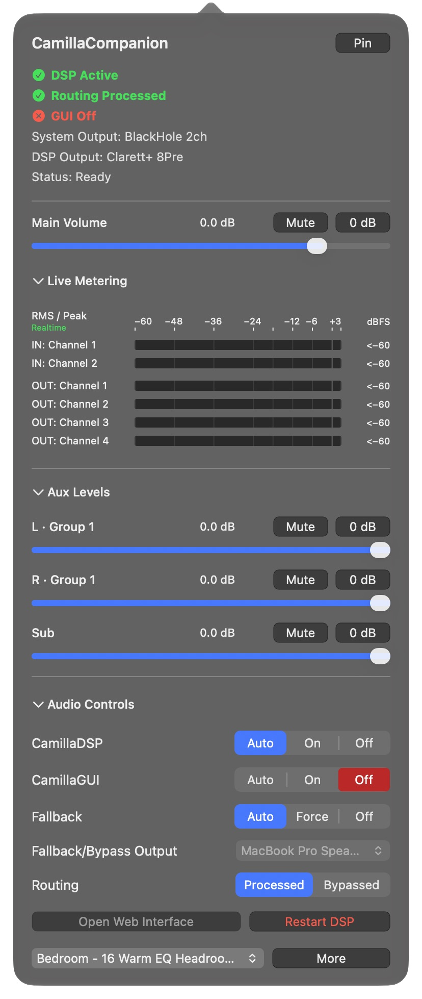

# CamillaCompanion

A macOS menu bar companion for CamillaDSP. Control volume, linked outputs,
presets and live meters, with optional automatic audio routing.

**First beta: `0.1.0-beta.1`.** For macOS 13 or later on Apple Silicon (ARM64).
Intel Macs have not been tested; this package contains an ARM64 executable only.
The beta uses ad-hoc signing without Apple notarization. Hardware testing currently covers one Clarett-based setup.

[Download beta for Apple Silicon](https://github.com/Edek/CamillaCompanion/releases/download/v0.1.0-beta.1/CamillaCompanion-0.1.0-beta.1-arm64.zip) · [Release notes](https://github.com/Edek/CamillaCompanion/releases/tag/v0.1.0-beta.1)

## Features

- Main volume and mute, plus named Aux faders with linked groups.
- Shift-drag or Shift-mute to adjust one Aux without unlinking its group.
- Input/output meters with synchronized Realtime and Peak Hold modes.
- Preset selection and optional CamillaGUI controls.
- DSP-only Companion Mode, or Automatic Switching with Processed/Bypassed routing.
- Configurable fallback output, Start at Login and a pinnable panel.
- Optional menu bar icon and direct access to the settings folder.
- Guided setup with a one-time search for existing DSP and GUI installations.

Settings validate and save changes without an Apply button. Meter reads stop
when the panel closes, metering is collapsed or DSP becomes unavailable. There
is no recurring device scan or idle health polling.

## Requirements and setup

Bring an existing CamillaDSP executable and working YAML configuration.
CamillaCompanion does not install CamillaDSP, CamillaGUI, virtual audio devices
or interface drivers. CamillaGUI is optional.

The current setup flow expects separate virtual capture and physical playback
outputs matching the YAML. It manages a configured local DSP job; it does not
attach to any independently running CamillaDSP instance.

[Build and stage the app](docs/building.md). For a new installation, place
`CamillaCompanion.app` in Applications and open it to start setup. See
[installation limits](docs/user-guide.md#install-and-open) for this non-notarized
beta. Stop any older controller before opening this build; it uses new settings
and startup names.

Use Setup’s **Find Automatically…** action or choose CamillaDSP and its configuration
manually, then select matching devices and an operating mode.
**Save Only** leaves audio unchanged. **Save and Activate** starts the configured
session. Opening the app again reveals its running panel. The development CLI
also provides `camillacompanion setup` and `camillacompanion launch`.

Follow the [first-time setup tutorial](docs/first-time-setup.md) for a step-by-step
walkthrough. The [user guide](docs/user-guide.md) covers startup, storage, controls,
updates and removal.

## Operating modes

| Mode | Behavior |
| --- | --- |
| Companion Mode | Controls the configured DSP without changing macOS outputs. DSP On waits for required hardware and resumes when it reconnects; Off stays Off. |
| Automatic Switching | Manages DSP and routes system audio through its virtual output when ready. Processed/Bypassed and fallback controls are available. |

For example, enable Automatic Switching with DSP and Fallback on **Auto**.
Connect the laptop’s configured USB interface: DSP starts and macOS audio routes
through BlackHole once processing is ready. While the app manages that route,
disconnecting returns audio to an available fallback, such as the MacBook
speakers. Reconnecting resumes processing.

Switch modes in **Settings > General > Automatic Switching**. Entering Companion
Mode keeps the current macOS output. Companion DSP Off and Quit also leave it
untouched. Bypassed routing keeps a healthy DSP running; it is not a mute button.

## Settings and support

Settings live in `~/Library/Application Support/CamillaCompanion/`.
**Open Settings Folder** reveals the active location. Quit before editing JSON
files directly. Older settings folders are not imported automatically.

Support development through [Ko-fi](https://ko-fi.com/camillacompanion).
Contributions are optional; all features remain available to everyone.

For a problem report, include the app version, operating mode, relevant status
and on-demand diagnostics. Review diagnostics for personal paths before sharing.
Project source and release information: [GitHub](https://github.com/Edek/CamillaCompanion).
CamillaDSP audio-engine buffer and underrun problems remain outside this app's
scope.

## Future roadmap

- Improve installation, updates and removal, and broaden macOS and hardware testing.
- Add interface profiles that associate each audio interface with its DSP configuration
  and an optional preset.
- Add a keyboard shortcut to show the panel, with mute shortcuts and Dim considered
  if users request them.
- Consider translations if there is demand.

These are future plans without committed dates. The first beta focuses on one
configured DSP setup; multi-interface setup is not included yet.

## Development and release status

[Build and checks](docs/building.md) · [Release notes](docs/release-notes.md) ·
[Source archive contents](docs/source-archive.md) · [Contributing](CONTRIBUTING.md)

## License

Copyright (C) 2026 CamillaCompanion contributors.

GNU General Public License, version 3 only (`GPL-3.0-only`). See
[LICENSE](LICENSE) and [third-party notices](THIRD_PARTY_NOTICES.md).
